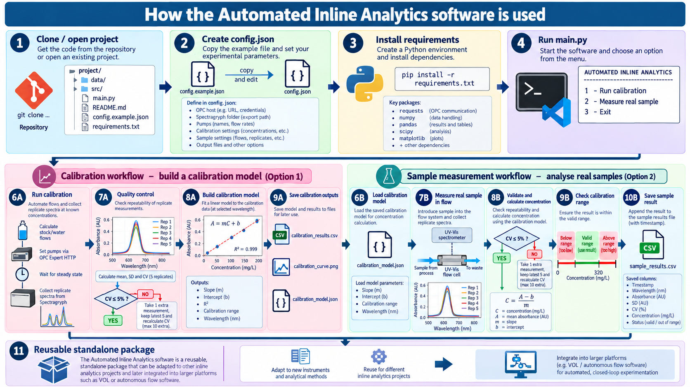

# Automated Inline Analytics

A modular Python framework for **automated inline calibration and validated real-sample measurement in continuous-flow systems**.

The package was developed as a reusable standalone tool for inline analytics and is designed so it can later be integrated into larger autonomous experimentation platforms.

The current implementation uses:

- **HiTec Zang pumps** controlled through the **OPC Expert HTTP interface**
- **Spectragryph** for continuous UV–Vis acquisition and CSV export
- Python for automated inline calibration, pump-based dilution, replicate acquisition, CV-based quality control, linear regression, calibration-model storage, real-sample concentration calculation, calibration-range checking, and persistent result logging.

The current test system uses methylene blue as a model analyte, but the software architecture is intended to be reusable for other inline analytical workflows.

---

## Software workflow



The software is intended to be used in two main modes:

```text
1 - Run calibration
2 - Measure real sample
3 - Exit
```

A calibration does not need to be repeated every time the software is started. Once a valid calibration has been created and saved as `calibration_model.json`, the software can directly perform real-sample measurements using that model.

---

## Repository structure

```text
automated-inline-analytics/
│
├── main.py
├── README.md
├── requirements.txt
├── .gitignore
├── config.example.json
├── calibration_model.example.json
│
├── CalibrationExperiment/
│   ├── __init__.py
│   └── calibration_experiment.py
│
├── DataAnalysis/
│   ├── __init__.py
│   └── data_analysis.py
│
├── PumpController/
│   ├── __init__.py
│   └── set_flow.py
│
├── SampleMeasurement/
│   ├── __init__.py
│   └── sample_measurement.py
│
├── Spectrometer/
│   ├── __init__.py
│   └── spectragryph_reader.py
│
└── assets/
    └── automated_inline_analytics_workflow_infographic.png
```

---

## Quick start

### 1. Clone the repository

```bash
git clone <repository-url>
cd automated-inline-analytics
```

### 2. Create a local configuration file

Copy:

```text
config.example.json
```

to:

```text
config.json
```

Then adapt `config.json` to the local experimental setup.

The real `config.json` is excluded from version control because it may contain machine-specific paths or internal hardware addresses.

### 3. Install dependencies

Python 3.10+ is recommended.

```bash
pip install -r requirements.txt
```

Current dependencies:

```text
requests
numpy
pandas
scipy
matplotlib
```

### 4. Configure Spectragryph

Spectragryph should:

- acquire spectra continuously
- save every acquisition automatically
- export spectra as CSV
- use automatic filename incrementing

Example:

```text
my_acquired_spectra_001.csv
my_acquired_spectra_002.csv
my_acquired_spectra_003.csv
```

The default file pattern used by the software is:

```text
my_acquired_spectra_*.csv
```

### 5. Run the software

```bash
python main.py
```

---

# Configuration

The package uses `config.json` for experiment- and machine-specific settings.

Example structure:

```json
{
    "opc": {
        "host": "http://YOUR_OPC_EXPERT_HOST:57080",
        "area": "E_CHEM"
    },
    "spectragryph": {
        "spectra_folder": "C:\\path\\to\\Spectragryph\\exports",
        "file_pattern": "my_acquired_spectra_*.csv"
    },
    "pumps": {
        "stock_pump": "PUMP1",
        "water_pump": "PUMP2"
    },
    "calibration": {
        "stock_concentration": 400.0,
        "total_flow": 2.0,
        "target_concentrations": [0, 80, 160, 240, 280, 320],
        "target_wavelength": 664.0,
        "wait_time": 60,
        "n_replicates": 5,
        "replicate_interval": 2.0,
        "cv_threshold": 5.0,
        "max_extra_measurements": 10
    },
    "sample_measurement": {
        "n_replicates": 5,
        "replicate_interval": 2.0,
        "cv_threshold": 5.0,
        "max_extra_measurements": 10
    },
    "output": {
        "calibration_results_file": "calibration_results.csv",
        "calibration_plot_file": "calibration_curve.png",
        "calibration_model_file": "calibration_model.json",
        "sample_results_file": "sample_results.csv"
    }
}
```

---

# Calibration workflow

Selecting:

```text
1 - Run calibration
```

starts the automated inline calibration.

For each target concentration, the software:

1. Calculates the required stock and water flow rates.
2. Writes the new pump setpoints through OPC Expert.
3. Waits for the specified settling time.
4. Reads the latest UV–Vis spectrum exported by Spectragryph.
5. Collects 5 replicate measurements.
6. Calculates mean absorbance, standard deviation, and coefficient of variation (CV).
7. Compares the CV against the acceptance threshold.
8. If CV is above the threshold, one additional spectrum is collected, only the latest 5 values are kept, and mean, SD, and CV are recalculated.
9. The process repeats until the CV is acceptable or the maximum number of additional measurements is reached.
10. The accepted calibration points are used for linear regression.

The current calibration model is:

\[
A = mC + b
\]

where:

- \(A\) = absorbance
- \(C\) = concentration
- \(m\) = slope
- \(b\) = intercept

---

## Calibration outputs

A calibration generates:

```text
calibration_results.csv
calibration_curve.png
calibration_model.json
```

The calibration model contains the fitted parameters required for later sample measurements.

Example:

```json
{
    "slope": 0.003794,
    "intercept": 0.009579,
    "r2": 0.9926,
    "range_min": 0.0,
    "range_max": 320.0,
    "wavelength": 663.857
}
```

Because the model is stored separately, a new calibration is **not required every time the program is started**.

---

# Using an existing calibration

If an inline calibration is not required, the software can use an externally determined calibration model.

Copy:

```text
calibration_model.example.json
```

to:

```text
calibration_model.json
```

and replace the example values with your own calibration parameters.

The required fields are:

- `slope`
- `intercept`
- `r2`
- `range_min`
- `range_max`
- `wavelength`

Example:

```json
{
    "slope": 0.003794,
    "intercept": 0.009579,
    "r2": 0.9926,
    "range_min": 0.0,
    "range_max": 320.0,
    "wavelength": 663.857
}
```

Once `calibration_model.json` is present, the user can select:

```text
2 - Measure real sample
```

without running the inline calibration workflow first.

This makes the package compatible with calibrations generated externally, manually, or by another analytical workflow.

---

# Real-sample measurement workflow

Selecting:

```text
2 - Measure real sample
```

loads the existing `calibration_model.json`.

The software then:

1. Loads slope, intercept, \(R^2\), calibration range, and analytical wavelength.
2. Reads the real sample in flow through the UV–Vis cell.
3. Collects 5 replicate spectra.
4. Calculates mean absorbance, SD, and CV.
5. Applies the same rolling CV validation used during calibration.
6. Converts mean absorbance into concentration using:

\[
C = \frac{A-b}{m}
\]

7. Checks whether the calculated concentration is below, inside, or above the calibration range.
8. Saves the result.

---

## Sample result logging

Every accepted sample measurement is appended to:

```text
sample_results.csv
```

The file can contain fields such as:

```text
timestamp
wavelength
absorbance
absorbance_sd
absorbance_cv
concentration
status
accepted
extra_measurements
calibration_slope
calibration_intercept
calibration_r2
```

Previous measurements are preserved.

---

# Quality-control strategy

The current default measurement validation uses:

```text
Initial measurements: 5
CV threshold: 5%
Maximum extra measurements: 10
```

If:

\[
CV \leq 5\%
\]

the measurement is accepted.

If:

\[
CV > 5\%
\]

the software:

1. collects one new spectrum
2. removes the oldest measurement
3. keeps the latest 5 values
4. recalculates mean, SD, and CV
5. repeats until the criterion is satisfied or the maximum number of extra measurements is reached

This rolling-window strategy provides basic self-validation of inline measurements.

---

# Main modules

## `PumpController`

Handles pump communication through OPC Expert.

Main methods:

```python
set_flow(pump, flow)
stop(pump)
stop_all()
```

A non-zero value written to the pump flow setpoint starts the pump; zero stops it.

The implementation also handles the decimal-separator format required by the current OPC Expert setup.

## `SpectragryphReader`

Reads continuously exported Spectragryph files.

Main methods:

```python
get_latest_file()
wait_until_file_ready()
read_spectrum(file_path)
get_absorbance(file_path, wavelength)
get_latest_absorbance(wavelength)
get_band_average(file_path, center, half_width)
```

Spectragryph runs independently and continuously. Python simply accesses the latest available spectrum when a measurement is required.

## `CalibrationExperiment`

Coordinates automated calibration.

Main methods:

```python
calculate_flows(target_concentration)
calculate_statistics(absorbance_values)
run_condition(target_concentration)
run_calibration(concentrations)
```

## `DataAnalysis`

Handles calibration analysis.

Main methods:

```python
linear_regression()
save_csv()
plot_calibration()
save_calibration_model()
```

## `SampleMeasurement`

Loads the saved calibration and performs validated real-sample measurement.

Main methods:

```python
load_calibration_model()
calculate_concentration(absorbance)
check_calibration_range(concentration)
calculate_statistics(absorbance_values)
measure_sample()
save_result(result)
```

---

# Generated files

The software may generate:

```text
calibration_results.csv
calibration_curve.png
calibration_model.json
sample_results.csv
```

These files are ignored by Git by default because they contain experiment-specific outputs.

---

# Current status

The standalone package currently supports:

- automated inline calibration
- automated pump-based dilution for calibration standards
- continuous Spectragryph file reading
- replicate UV–Vis measurements
- mean / SD / CV calculation
- rolling CV validation
- linear calibration fitting
- calibration model storage
- use of externally generated calibration models
- real-sample concentration calculation
- calibration-range checking
- persistent sample result logging
- external configuration through `config.json`

---

# Planned improvements

Potential future developments include:

- automated waiting-time calculation based on flow rate and system volume
- automatic dilution of real samples above the calibration range
- improved steady-state detection
- calibration validity / drift checks
- automatic blank handling
- nonlinear or multivariate calibration models
- support for multiple analytical wavelengths
- metadata-rich experiment logging
- graphical user interface
- support for additional analytical techniques
- integration into larger autonomous flow platforms such as VOL

---

# Reusability

Although the current demonstration uses inline UV–Vis spectroscopy, the software is intentionally modular.

The same architecture can be adapted to:

- other analytes
- other concentration ranges
- other pumps
- other spectrometers
- other process analytical technologies
- other continuous-flow platforms

The goal is to keep the analytical workflow independent enough that it can be reused as a standalone package or integrated into larger self-driving laboratory systems.

---

# License

A license has not yet been selected.

Before public release, an appropriate open-source license should be chosen according to the intended use and institutional requirements.
