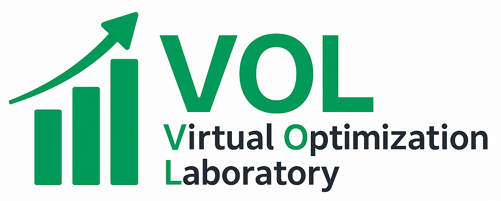

# Streamlit_VOL



Virtual Optimization Lab is a Streamlit application for autonomous optimization of continuous-flow experiments. It combines experiment setup, optimization loops, protocol selection, and data persistence in one interface.

## Current Capabilities

- Single-objective Bayesian optimization
- Multi-objective Bayesian optimization
- DOE execution from external matrices
- Running protocol selection from Python files in `running_protocols/`
- Protocol browser with source preview and optional scheme images
- OPC-based hardware control (real, hybrid, or simulated modes)
- Stop/resume and reload of saved runs
- Data analysis and experiment database pages

## App Pages

- `Home.py`: overview and getting started
- `Single_Objective.py`: autonomous single-objective optimization
- `Multi_Objective.py`: autonomous multi-objective optimization
- `DoE_Executor.py`: execute DOE matrices
- `Reproducibility.py`: centralized reproducibility configuration
- `Running_Protocols.py`: browse and select protocol files
- `Data_Analysis.py`: visualize and compare runs
- `preview_run.py`: inspect saved run payloads
- `experiment_database.py`: browse experiment records

## Running Protocol Workflow

Protocols are plain `.py` files stored in `running_protocols/`.
You can duplicate `running_protocols/example_protocol.py` and adapt it for each reaction.

Typical optional hooks in a protocol file:

- `protocol_info() -> dict`
- `required_parameter_keys() -> list[str]`
- `prepare_hardware(runner, parameters)`
- `calculate_real_result(runner, mean_measurement, parameters, objectives, directions)`
- `autosampler_flow_rate(runner, parameters)`
- `cleanup(runner, parameters)`
- `measurement_tag(runner, parameters)`

If a hook is missing, the default process-adapter behavior is used.

## Reproducibility Workflow

- Configure reproducibility in `Reproducibility.py` to avoid crowding optimization pages.
- Single and Multi pages keep only compact gate status and use the centralized settings.
- Reproducibility seed points are imported as initialization data automatically.
- If additional initialization points are needed, missing points are generated by the selected init strategy.

### Measurement source per reaction

- Set measurement source from the GUI sidebar using `Measurement OPC Prefix` and `Measurement Signal`.
- Or set it in a protocol with `measurement_tag(runner, parameters)`.
- Protocol `measurement_tag(...)` takes priority over sidebar prefix/signal values.

## UV/VIS measurements with a saved calibration

Single Objective, Multi-Objective, and DOE Executor offer **Measurement method → UV/VIS (Spectragryph CSV)** in the sidebar.

1. Set Spectragryph to acquire continuously, export CSV with one information row followed by a wavelength/absorbance header, and increment filenames automatically.
2. Select the export folder and saved calibration JSON. Relative paths resolve from the VOL project folder.
3. Select the concentration unit used to fit the calibration, such as `mM`. The coefficients and calibration range must already use this unit. Changing the unit label does not convert an existing calibration. Use matching substrate units when calculating yield.
4. Click **Test UV/VIS measurement** to acquire a sample without starting pumps, power supplies, an autosampler, or an optimization campaign. The sample must already be flowing through the UV/VIS cell.
5. Once that measurement is accepted, select `Concentration` as the first optimization/DOE objective and run the usual reaction protocol.

The calibration requires `slope`, `intercept`, `r2`, `range_min`, `range_max`, and `wavelength`. An optional `concentration_unit` field is checked against the sidebar selection. Legacy models without a unit use the explicitly selected unit. The supplied methylene-blue example is labelled `mg/L`; replace its coefficients with your measured calibration before using another unit.

Each measurement waits for distinct, complete exports created after acquisition begins, then uses the inline analytics rolling absorbance CV check. Defaults are five replicates, CV ≤ 5%, and up to ten extra spectra. Stale files, invalid spectra, timeouts, failed CV, and concentrations outside the calibration range cannot update the optimizer. A failed experiment runs the protocol cleanup path and reports the error. Calibration is loaded before hardware preparation and retained for the campaign; resuming checks that its contents have not changed.

Run results include concentration unit, absorbance statistics, range/acceptance flags, and calibration identity. Raw readings, spectrum paths, and the calibration model are saved to `raw_measurements/<run>_uvvis_measurements.csv`. Acquisition settings are preserved in run metadata and campaign templates. Existing runs without a measurement method default to OPC. Hybrid/full simulation use synthetic measurements; the measurement test button always reads real CSV exports.

This integration only measures using a saved calibration. Automated calibration remains available in the standalone inline analytics tool.

Hardware-free checks:

```bash
python -B -m unittest discover -s tests -p test_uvvis_integration.py -v
```

## Project Structure (Key Paths)

- `main.py`: Streamlit entry point and page routing
- `core/hardware/experimental_run.py`: `ExperimentRunner` orchestration
- `core/hardware/protocol_scripts.py`: protocol discovery and loading
- `core/hardware/process_adapters.py`: default adapter behavior
- `running_protocols/`: reaction-specific protocol files
- `running_protocols/assets/`: optional protocol scheme images

## Installation

1. Create and activate a virtual environment.
2. Install dependencies:

```bash
pip install -r requirements.txt
```

## Run the App

```bash
streamlit run main.py
```
