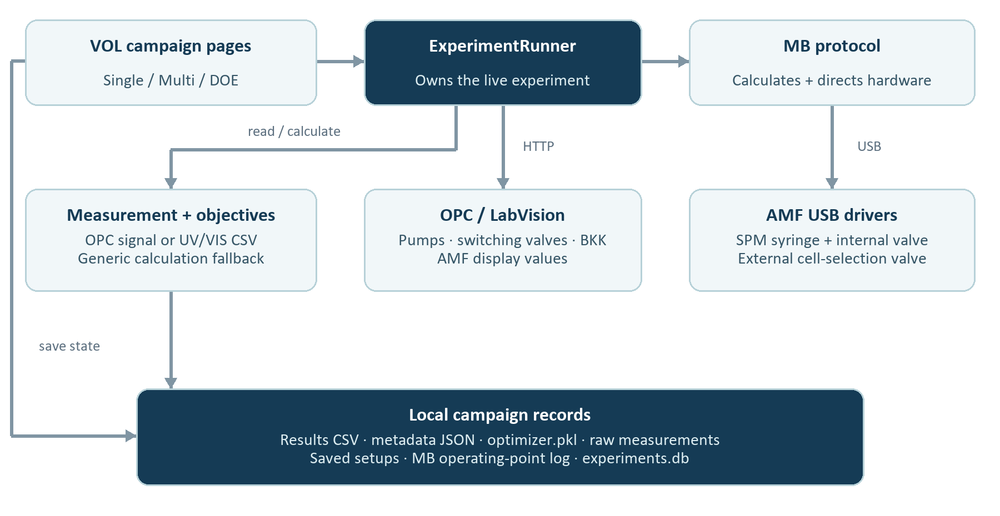

# MB Protocol Manual

**Virtual Optimization Lab (Streamlit_VOL)**  
Operator and developer reference · Version 1.7 · 23 November 2026

Based on the current working copy, including matched inlet/outlet cell routing, waste diversion during startup, a volume-based UV/VIS branch flush and automatic downstream dilution, with selectable CV/SD spectral stability. This document describes implemented software behavior and identifies the analytical work that remains to be validated. Source references [S1]–[S17] appear in the final section.

<!-- MANUAL BODY -->

# 1. Quick operating reference

The MB protocol automates methylene blue electrooxidation using six optimization variables, three selectable electrochemical cells, and three electrolyte stocks. VOL proposes or loads a condition, the protocol converts it into hardware settings, the runner obtains a measurement, and the selected objective values are returned to the optimizer.

## Current configuration

| Item | Current setting |
|---|---|
| Protocol selected in VOL | `MB_6_variables.py` |
| MB feed stock | 2,000 mg/L; molecular-weight assumption 319.85 g/mol |
| Electrolyte stocks | Na₂SO₄, NaCl and NaNO₃, each 0.4 mol/L |
| SPM syringe | 5,000 µL; internal port 1 waste, port 5 reactor delivery |
| First preparation after start/resume | Home to waste, rinse twice with 1,000 µL incoming stock, fill to 5,000 µL |
| Between matching-electrolyte experiments | Retain remaining stock and top up to 5,000 µL |
| Water/ethanol/water cleaning | Water / ethanol / water: Pump 2 for 60 s, Pump 6 for 60 s, Pump 2 for 90 s; each at 2 mL/min; through the selected cell and UV/VIS |
| Cell routing | ROT_VALVE at the cell inlet and AMF at the outlet; matching ports 1/2/3 for EC1/EC2/EC3 |
| Electrolysis mode | Both V_02 tags = 0; V_01 stays at waste (0) until the measurement phase |
| Cleaning mode | Both V_01 tags = 1; V_02 = 0 for water and 1 for ethanol |
| UV/VIS branch flush | 1 mL after switching V_01 to UV/VIS; time = 60 * volume / reactor flow |
| Real MB UV/VIS | mg/L calibration; direct first, automatic downstream water dilution if above range |
| Analytical dilution | Pump 3 maximum 6.25 mL/min; 10 s wait per flow setting; up to 6 attempts including direct |

> **Latest valve mapping:** “Both tags” means OPEN and CLOSE. V_02 selects electrolysis/cleaning; V_01 independently selects UV/VIS/waste. These are the rebuilt MB setup’s command values; do not substitute settings from an older PDA protocol.

## What is already automated

Cell selection, electrolyte routing and syringe preparation, current and flow calculations, reagent delivery, BKK channel commands, waiting periods, measurement collection with optional automatic UV/VIS dilution, feed shutdown, water/ethanol/water cleaning, result handling and serial-connection cleanup are coordinated by the software.

## What needs analytical validation

The MB module currently does not define its own objective-calculation or measurement-tag hook. The runner therefore uses the selected process adapter and measurement configuration. Select Degradation for apparent MB removal from the corrected outlet concentration. Generic yield, throughput and solvent metrics are not MB-removal responses. Review Section 14 before using analytical results to drive optimization. [S1, S3, S6]

<!-- pagebreak -->

# 2. Software and hardware connections



The Streamlit pages own the campaign and its optimizer. `ExperimentRunner` owns the live hardware connections and calls protocol hooks for each experiment. The MB protocol calculates operating settings and requests the corresponding hardware actions. [S1–S5]

| Component | Main responsibility |
|---|---|
| `main.py` | Loads the selected Streamlit page |
| `Single_Objective.py`, `Multi_Objective.py` | Build initialization points, suggest conditions, execute runs and persist optimizer/results |
| `DoE_Executor.py` | Executes rows from an externally prepared matrix |
| `core/hardware/experimental_run.py` | Creates devices, calls hooks, measures, calculates results, shuts down and cleans |
| `running_protocols/MB_6_variables.py` | MB-specific calculations, routing, syringe handling and water/ethanol/water cleaning |
| AMF driver wrappers | Control the SPM+ and external RVMFS valve over USB |
| `OPCClient` | Sends reads/writes through the configured OPC Expert HTTP endpoint |

**Two separate communication paths:** AMF devices receive movement commands directly over USB. Their LabVision values are separate OPC display updates. Other pumps, switching valves and the BKK are addressed through OPC/LabVision. A displayed AMF value does not itself control the USB device.

<!-- pagebreak -->

# 3. Physical layout and units

## Reaction and cleaning pumps

| Device | Role | Command units / behavior |
|---|---|---|
| Pump 1 | 2,000 mg/L MB stock | µL/min; calculated mL/min × 1,000, rounded to whole µL/min |
| Pump 2 | Reaction dilution and cleaning water | µL/min; calculated mL/min × 1,000, rounded to whole µL/min |
| SPM+ | Selected 0.4 M electrolyte stock | µL and µL/min; USB commands |
| Pump 3 | Downstream analytical dilution water | µL/min; automatic only for real MB UV/VIS; excluded from reaction flow |
| Pump 6 | Ethanol cleaning | **mL/min**; a value of 2 means 2 mL/min, not 2,000 |

## Inlet/outlet cell selectors and BKK mapping

| Cell label | Structure | Area (cm²) | Cell volume (µL) | Inlet / outlet ports / BKK channel |
|---|---|---|---|---|
| EC1 | Fin | 4.740 | 120.54 | 1 / 1 / 1 |
| EC2 | Meandering | 6.310 | 160.38 | 2 / 2 / 2 |
| EC3 | Tangential | 4.850 | 123.38 | 3 / 3 / 3 |

The metadata also records a 0.254 mm gap, graphite anode and stainless-steel cathode. Area, volume, shared inlet/outlet port and BKK channel are looked up from the cell label. [S1]

## SPM internal valve

| Port | Connection |
|---|---|
| 1 | Waste; mandatory for startup homing |
| 2 | Na₂SO₄ stock |
| 3 | NaCl stock |
| 4 | NaNO₃ stock |
| 5 | Reactor delivery |

ROT_VALVE.POS now selects the cell inlet; the external USB AMF valve selects the matching cell outlet. Ports 1, 2 and 3 correspond to EC1, EC2 and EC3 on both selectors. The flow path is reaction feeds or cleaning liquids → ROT_VALVE → selected cell → AMF outlet selector → downstream analytics. Pump 6 receives ethanol directly; Pump 2 supplies water. The SPM internal valve remains dedicated to electrolyte stock handling.

<!-- pagebreak -->

# 4. Campaign variables and valid conditions

Define the following six variables in the optimization page. Use the exact internal IDs; selecting their catalog names in VOL supplies these IDs. [S1, S9]

| Internal ID | Type | Meaning / units |
|---|---|---|
| `current_density` | Continuous | Applied current density, mA/cm² |
| `applied_charge` | Continuous | Applied charge per mole of MB, F/mol |
| `substrate_concentration` | Continuous | Target inlet MB concentration, mg/L |
| `electrolyte_concentration` | Continuous | Target inlet electrolyte concentration, mol/L |
| `cell` | Categorical | `EC1, EC2, EC3` |
| `electrolyte` | Categorical | `Na2SO4, NaCl, NaNO3` |

Enter category choices separated by commas. VOL trims spaces and removes duplicate labels. Labels are passed to the protocol and retained in saved data. Optimizer encoding is internal; there is no universal integer code that the operator must enter for an electrolyte or cell.

## Implemented feasibility checks

- Current density, applied charge and both target concentrations must be positive.
- MB target must be below the 2,000 mg/L stock concentration.
- Electrolyte target must be below its selected stock concentration, currently 0.4 M.
- Calculated total reaction flow must be at least 0.45 mL/min.
- MB and electrolyte flows must be positive; calculated water flow cannot be negative.
- Electrolyte delivery must be at least 50 µL/min.

The nonnegative-water condition implies:

```text
C_MB / 2000 + C_electrolyte / 0.4 ≤ 1
```

This is a coupled constraint: individually valid concentration bounds can still create an invalid combination. In real/hybrid execution, an invalid proposed condition raises an error and stops the current campaign; the MB protocol does not automatically request a replacement suggestion.

> **Bounds are operational choices.** The checks above do not establish maximum safe current, pump flow, pressure, electrode loading or instrument limits. Configure campaign bounds using the actual setup’s established operating range. Full simulation skips MB hardware preparation and is not a validation of these physical limits.

<!-- pagebreak -->

# 5. Calculating current, flows and waiting times

`_compute_operating_point()` converts a parameter dictionary into an operating-point dictionary. It does not move hardware. Its output is printed and used by preparation and logging. [S1]

| Symbol | Meaning |
|---|---|
| j, A, I | Current density (mA/cm²), electrode area (cm²), current (A) |
| q | Applied charge (F/mol) |
| F | Faraday constant = 96,485.33212 C/mol |
| C_MB | MB target at cell inlet, mg/L |
| MW | MB molecular weight = 319.85 g/mol, anhydrous assumption |
| C_E, C_E,stock | Electrolyte target and stock concentration, mol/L |
| Q | Total reaction flow, mL/min; excludes Pump 3 |

```text
I_mA = j × A                         I_A = I_mA / 1000
C_MB,mM = C_MB,mg/L / MW
Q = I_A × 60 × 10^6 / (F × q × C_MB,mM)
Q_MB = Q × C_MB / 2000
Q_SPM = Q × C_E / C_E,stock
Q_water = Q − Q_MB − Q_SPM
```

Cell volume is converted from µL to mL before timing calculations:

```text
t_cell = 60 × V_cell / Q
t_flush = 60 × (V_upstream + 2 × V_cell) / Q
t_wait = 3 × t_cell + 60 × V_downstream / Q
t_SPM_capacity,min = 5000 / Q_SPM,µL/min
```

`t_flush` occurs before power is enabled. `t_wait` occurs after current is set and power is enabled, with V_01 still directed to waste. Then V_01 switches to UV/VIS and the branch is flushed for `60 * V_UVVIS_flush / Q` seconds. The default branch flush is 1.0 mL; Pump 3 remains stopped. The existing acquisition/dilution settling wait follows this flush.

> **Dead-volume placeholders:** `UPSTREAM_DEAD_VOLUME_ML` and `DOWNSTREAM_DEAD_VOLUME_ML` are both currently 0.0. The calculated startup waits therefore omit unmeasured transport volumes. DOWNSTREAM_DEAD_VOLUME_ML now covers the reactor outlet to the diversion valve, including any separator. Enter the measured volumes. Separately validate that the 1 mL analytical branch flush clears the tubing after V_01 and the flow cell. A stable detector signal alone does not prove that a new formulation has reached the detector.

<!-- pagebreak -->

# 6. Worked operating-point example

This example uses a previously tested condition and is recalculated from the current protocol. It illustrates the calculation, not a recommended optimization range.

| Input | Value |
|---|---|
| Cell / electrolyte | EC3 / NaCl |
| Current density | 3.028 mA/cm² |
| Applied charge | 6.753 F/mol |
| Target MB | 309.39 mg/L |
| Target electrolyte | 0.0666 mol/L |

| Calculated output | Value |
|---|---|
| Total current | 14.686 mA (0.014686 A) |
| Reaction total flow | 1.3981 mL/min |
| Pump 1 MB stock | 0.2163 mL/min |
| Pump 2 water | 0.9490 mL/min |
| SPM electrolyte | 0.2328 mL/min (232.8 µL/min) |
| Cell residence time | 5.29 s |
| Pre-electrolysis flush | 10.59 s |
| Post-power response wait to waste | 15.88 s |
| UV/VIS branch flush (1 mL) | 42.92 s |
| Nominal SPM delivery capacity | 21.48 min |

The current depends on the selected cell’s area. Changing EC3 to another cell while retaining the same current density changes both current and calculated total flow. Cell selection is therefore part of the operating-point calculation, not only a valve change.

## Reading the timing estimate

The syringe capacity estimate covers delivery at the calculated reaction electrolyte rate. Actual electrolyte consumption also includes the pre-electrolysis flush, the post-power wait to waste, the 1 mL UV/VIS branch flush, measurement acquisition and any enabled sample collection before the SPM is stopped.

No automatic mid-experiment refill or remaining-volume watchdog is implemented. If the syringe reaches its zero target, the physical movement ends; the code does not automatically load another syringe during that experiment. Compare the full experiment duration with capacity before choosing long acquisition or sample-collection settings.

Cleaning alternates Pump 2 water and Pump 6 ethanol after SPM shutdown. It does not consume the retained electrolyte in the SPM syringe. [S1, S3, S7]

<!-- pagebreak -->

# 7. One experiment, from proposal to saved result

1. **Choose the condition.** The page takes an initialization point, optimizer suggestion or DOE row and builds the six-parameter dictionary.
2. **Enter the runner.** `run_experiment()` validates the selected UV/VIS provider when applicable, then calls the MB preparation hook.
3. **Compute and print.** The protocol calculates current, flows, selected ports and waiting times. Invalid conditions stop here.
4. **Establish a stopped state.** Power-off commands, Pump 6 stop and reaction-feed stops are issued and checked. The SPM is homed once for a new runner, or its stopped state is checked for a continuing runner.
5. **Establish electrolysis and waste routing.** V_02 OPEN/CLOSE = 0; V_01 OPEN/CLOSE = 0 (waste). Command readbacks must match before feeds start.
6. **Select the cell.** With power and all pumps stopped, set the AMF outlet and ROT_VALVE inlet to the matching cell port (1, 2 or 3). Verify the inlet OPC command and the AMF reported position; update the AMF OPC display.
7. **Prepare electrolyte.** Top up matching stock, or discard/rinse/fill when stock identity is unknown or different. End on SPM delivery port 5.
8. **Start reaction feeds.** Write Pump 1 and Pump 2 flows; start nonblocking SPM delivery toward an empty syringe.
9. **Flush without electrolysis.** Wait the calculated upstream/cell flush time.
10. **Select electrical output.** Recheck both cell-routing readbacks after flushing. Send the matching BKK channel commands, write the calculated current in amperes, and enable the power supply.
11. **Wait to waste, then flush UV/VIS.** Keep V_01 at waste during the calculated post-power stabilization/transport wait. Switch only V_01 to UV/VIS (both tags = 1), verify its commands, then pass 1 mL at the calculated reactor flow before acquisition. Discard spectra exported during these waits.
12. **Measure and calculate.** For real MB UV/VIS, stop Pump 3, wait 10 s and collect fresh spectra. Above-range readings trigger bounded dilution retries, each with a 10 s wait. Return the dilution-corrected reactor-outlet concentration to the selected objective calculator. Stop Pump 3 and, after a diluted success, wait 10 s for undiluted flow before optional autosampling. Other measurement modes retain their existing acquisition path.
13. **Divert, stop and clean.** Return V_01 to waste before normal power/feed shutdown. A failed diversion still allows all shutdown attempts and blocks automatic cleaning. A successful experiment with verified shutdown receives the water/ethanol/water sequence through the selected cell and UV/VIS. Afterwards both cleaning pumps stop, V_02 returns to electrolysis and V_01 returns to waste.
14. **Accept and persist.** Only after the runner returns successfully does the page observe the result in the optimizer and write its campaign checkpoint.

> **Cleanup is part of success.** If measurement succeeds but cleaning or final shutdown fails, the runner raises an error. The result is not accepted as a normal optimizer observation. Raw measurements can still exist for that attempted run. [S1, S3]

<!-- pagebreak -->

# 8. SPM syringe management

## New or resumed campaign

The runner opens the SPM with `auto_home=False`; MB preparation performs the controlled startup home after validating waste routing. Homing always uses internal port 1. The protocol requires that port to be connected to waste.

Startup stops previous motion and permits an explicit home from ready, stopped, not-homed or the known out-of-range status 145. Mechanical and sensor faults are not automatically cleared. Homing has a 120 s timeout and must finish with a ready pump, a homed device, internal valve on port 1 and an empty syringe. [S7]

| State at preparation | Action |
|---|---|
| Contents unknown, including a fresh/resumed runner | Home once; rinse twice with 1 mL incoming stock; fill to 5 mL |
| Same electrolyte, same stock concentration, same source port | Retain contents; add only the missing volume to reach 5 mL |
| Different electrolyte, concentration or source | Empty through waste, rinse twice with incoming stock, fill to 5 mL |
| Busy, faulted, unhomed or inconsistent encoder state | Refuse normal refill; stop the campaign |

Stock identity is held only on the live runner as the electrolyte label, stock molarity and source port. Saved optimizer history is not evidence of the liquid currently inside the syringe. A restarted or resumed runner treats contents as unknown.

## Absolute volume and encoder readings

The driver uses an absolute target volume rather than adding a full relative 5 mL pickup to whatever is already present. A syringe containing 3.2 mL receives a 1.8 mL top-up when retaining the same stock.

Remaining volume comes from the real encoder position. A full stroke is 3,000 steps in standard resolution or 24,000 steps in high resolution. With the configured 5 mL syringe, **3,000 standard steps means 5,000 µL**, not 3,000 µL. The commanded position can be zero during an ongoing dispense and must not be used as the remaining volume.

USB operations remain on one execution thread. Nonblocking delivery uses the SDK’s command mode; there is no background syringe-control thread.

<!-- pagebreak -->

# 9. BKK selection, valve modes and LabVision display

## Electrical selection

The selected cell supplies the BKK channel: EC1 → 1, EC2 → 2, EC3 → 3. `_select_bkk_channel()` writes 1 to the selected channel tag and 0 to the other two, using the full OPC item IDs in Appendix A. Power is commanded off before preparation and enabled after matching inlet/outlet readbacks, channel selection and current setting.

The current command is sent in amperes. The MB protocol does not configure a BKK control-mode selector or voltage-compliance limit; establish the intended current-control configuration on the actual system before a campaign.

The channel-selection helper currently does not read the channel values back. Its printed selection message is not proof of physical output switching. Mode and shutdown verification elsewhere must not be interpreted as BKK channel feedback.

## Latest switching-valve commands

| Tag | Electrolysis | Cleaning |
|---|---|---|
| V_01_OPEN | 0 startup; 1 measurement | 1 for every rinse |
| V_01_CLOSE | 0 startup; 1 measurement | 1 for every rinse |
| V_02_OPEN | 0 | 0 water; 1 ethanol |
| V_02_CLOSE | 0 | 0 water; 1 ethanol |

`_set_flow_mode()` controls V_02 only. `_set_uvvis_route()` controls V_01 only; 0 selects waste and 1 selects UV/VIS. Each helper writes its two tags and reads the same OPC command items back. It tries up to three checks, with a 0.25 s interval; control reads/writes use a 2 s request timeout. A mismatch or unavailable readback blocks the next phase. These checks do not use independent mechanical position sensors. [S1, S8]

## AMF display values

| LabVision item suffix | Meaning |
|---|---|
| `AMF_MULTIPORT_VALVE` | Reported position of the external USB cell-outlet selector |
| `AMF_SPM_MULTIPORT` | Reported internal SPM valve position, including verified homing |
| `AMF_PUMP_FLOW` | Device-configured motion rate in µL/min while commanded movement is active |

Configuring a speed while idle displays zero. A confirmed blocking movement completion or stop also displays zero. An uncertain stop does not publish a false zero. Display writes use a 1 s timeout and are best effort, so a display-server failure does not prevent USB shutdown. The flow value is not a flow-sensor measurement or a continuously polled motion watchdog. [S3]

<!-- pagebreak -->

# 10. Water/ethanol/water cleaning between experiments

Both rotary selectors retain the selected cell throughout cleaning. All three rinses pass through UV/VIS with V_01 OPEN/CLOSE = 1. Pump 2 supplies water through V_02 = 0; Pump 6 supplies ethanol through V_02 = 1. Cleaning runs after each successful hardware experiment, including QC, the final experiment and protocol-aware maintenance calls. [S1, S3]

| Stage | Liquid | Pump | Flow (mL/min) | Time (s) | Volume (mL) |
|---|---|---|---|---|---|
| 1 | Water | 2 | 2 | 60 | 2 |
| 2 | Ethanol | 6 | 2 | 60 | 2 |
| 3 | Water | 2 | 2 | 90 | 3 |

The default sequence takes 210 s (3.5 min) and delivers a nominal 7 mL. Pump 2 commands use uL/min: 2 mL/min is written as 2000. Pump 6 commands use mL/min: 2 mL/min is written as 2. Timers begin after each flow command is verified; solvent-change and verification overhead is additional.

1. Confirm power-off commands, all reagent feeds stopped and the SPM ready/idle. Confirm the retained inlet/outlet cell ports.
2. Before each stage, confirm Pump 2 and Pump 6 are stopped. Select V_02 = 0 for water or 1 for ethanol, then verify V_01 = 1 for UV/VIS.
3. Start only the designated pump and run its timer. Stop and verify both cleaning pumps before any next valve change; recheck the retained cell ports and stage routing.
4. After the final water rinse, confirm stopped pumps, restore V_01 to waste (0) and V_02 to electrolysis (0). Recheck the retained cell ports. The next experiment still performs its normal startup-to-waste and analytical-branch flush.

<!-- pagebreak -->

## Cleaning settings

| Setting | Default | Adapter override |
|---|---|---|
| CLEANING_FLOW_ML_MIN | 2.0 mL/min | cleaning_flow_ml_min |
| CLEANING_WATER_PRE_DURATION_S | 60 s | cleaning_water_pre_duration_s |
| CLEANING_ETHANOL_DURATION_S | 60 s | cleaning_ethanol_duration_s |
| CLEANING_WATER_POST_DURATION_S | 90 s | cleaning_water_post_duration_s |

Overrides belong in process_adapter_config. Per-stage flow overrides are cleaning_water_pre_flow_ml_min, cleaning_ethanol_flow_ml_min and cleaning_water_post_flow_ml_min; each overrides the common flow. Explicit cleaning_ethanol_duration_s takes precedence over the older cleaning_duration_s alias, which now applies only to the Pump 6 ethanol step. All flows and durations must be finite and positive; all three stages are validated before any cleaning flow starts. cleaning_water_port remains ignored because ROT_VALVE selects the cell, not a solvent.

## Failure behavior

Failed experiments and unverified feed shutdowns do not start automatic cleaning. An interrupted stage, failed start or failed readback aborts all remaining stages. Both cleaning-pump stops are attempted even if one fails. If either stop is uncertain, neither switching valve is moved. Confirmed stopped pumps allow restoration of the waste/electrolysis route; the original error still propagates and blocks normal optimizer acceptance. OPC command readbacks do not independently measure physical pump flow or valve position.

The SPM retains its separate electrolyte contents. These rinses do not aspirate ethanol into the syringe; SPM stock changeover remains a separate operation. Validate removal of blue residue and ethanol carryover on the actual setup. Spectragryph can continue exporting during rinses; the next measurement uses fresh spectra after the next startup and UV/VIS branch flush.

<!-- pagebreak -->

# 11. Selecting a measurement source

Measurement collection belongs to the runner and its measurement mixin, not to MB flow calculation. Select the backend in the sidebar’s **Measurement Source** controls. [S3, S10, S11]

| Execution mode | AMF / OPC hardware actions | Measurements used in the experiment |
|---|---|---|
| Real hardware (`off`) | Executed | Selected OPC signal or calibrated UV/VIS CSV backend |
| Hybrid (`hybrid`) | Executed, including power and cleaning | Synthetic measurements |
| Full simulation (`full`) | Hardware preparation and cleaning skipped | Synthetic measurements |

> **Hybrid operates hardware.** It is not a no-motion or power-disabled test mode. Full simulation is the mode that skips hardware execution. Its synthetic objective path uses generic legacy assumptions, so it does not validate MB chemistry or hydraulic feasibility.

## OPC measurement backend

The measurement tag is resolved in this order: an explicit full tag on the runner, an optional protocol `measurement_tag()` hook, then the configured prefix plus signal. The MB protocol currently supplies no measurement-tag hook.

The generic UI defaults are `OpusOPCSvr.HP-CZC3484P17->` and `PDA - mM`. They are legacy defaults, not a confirmed MB measurement. Enter the actual calibrated MB item before using the OPC backend. The code treats the returned value as a number; it does not add MB calibration or dilution correction.

The default stability procedure takes three readings, 20 s apart in real mode. It checks their rolling three-point window, adding readings up to 15 total if needed. For a mean below 10 it requires an absolute standard deviation below 0.5; otherwise it requires RSD below 3%. These thresholds are in the measurement’s own units. The returned value is the mean of the final accepted three-point window, while the log retains all collected readings.

## Test button versus experiment

**Test UV/VIS measurement** reads actual exported spectra without controlling hardware, even when the experiment mode is hybrid or full simulation. The experiment itself still uses synthetic measurements in those modes. Testing the button is not evidence that a campaign is using real UV/VIS results. The test never starts Pump 3 or applies automatic dilution. Automatic dilution belongs to real MB experiments only; OPC, hybrid and full simulation do not use it.

<!-- pagebreak -->

# 12. UV/VIS calibration and acquisition

The `uvvis` backend reads Spectragryph CSV exports, applies a saved linear calibration and returns a validated concentration. It does not control the spectrometer acquisition program or create a calibration automatically. [S10–S12]

## Setup procedure

1. Prepare and validate a calibration using the intended concentration unit and optical configuration. Save the calibration JSON.
2. Configure Spectragryph to export continuously to the chosen folder with incrementing filenames.
3. Select **UV/VIS (Spectragryph CSV)**, the export folder, filename pattern and calibration file in VOL.
4. For MB automatic dilution, select **mg/L** and use the MB calibration fitted with mg/L standards. Other units are rejected before hardware preparation. A label change does not convert calibration coefficients or concentrations.
5. Choose CV, SD or Automatic CV / SD under UV/VIS acquisition settings. SD and automatic mode require a positive maximum absorbance SD in AU; it starts unset. Use Test UV/VIS measurement with a known sample and inspect concentration, absorbance, SD, CV, the decision criterion and calibration-range status.
6. Select real hardware mode for a campaign that must use these measurements.

| Configuration key | Default |
|---|---|
| `spectra_folder` | Empty; must be supplied |
| `file_pattern` | `my_acquired_spectra_*.csv` |
| `calibration_file` | `InlineAnalytics/calibration_model.json` |
| `concentration_unit` | `mM` |
| `n_replicates` / `replicate_interval` | 5 / 2 s |
| `stability_mode` | cv; options cv, sd, auto |
| `cv_threshold` | 5% absorbance CV |
| `sd_threshold` | Unset; positive AU limit required for sd/auto |
| `max_extra_measurements` | 10 |
| `spectrum_timeout` | 30 s per new spectrum |

The model must contain finite `slope`, `intercept`, `r2`, `range_min`, `range_max` and `wavelength` values. Concentration is `(absorbance − intercept) / slope`. The slope must be nonzero, the concentration range ordered, wavelength positive and R² between 0 and 1.

<!-- pagebreak -->

## Spectral stability and fresh acquisition

| Mode | Acceptance criterion |
|---|---|
| CV (%) | CV must not exceed the configured percentage limit. |
| SD (AU) | Sample SD must not exceed the configured absolute AU limit. |
| Automatic CV / SD | Use the larger SD allowance: the absolute AU limit or abs(mean absorbance) * CV limit / 100. |

At measurement start, existing filenames are marked as already seen. The reader waits for a distinct new, stable CSV, checks that it covers the calibration wavelength and uses its nearest wavelength point. Reusing one fixed filename is therefore unsuitable. A final in-range reading must also pass the selected stability check: CV (%), SD (AU), or automatic s_A <= max(SD_limit_AU, abs(mean_A) * CV_limit_pct / 100). Set a positive SD tolerance from blanks and low standards before using SD/automatic mode. Automatic mode uses the absolute allowance near zero and the CV allowance at higher signals. The rolling-window limits and whole-experiment reproducibility gate are unchanged. In a real MB experiment, an above-range reading can trigger the dilution procedure in Section 13; it is never accepted as a final result. The standalone test and protocols without dilution hooks do not retry using a pump. Unresolved range, stability or acquisition failures prevent a normal optimizer observation.

A SHA-256 calibration ID is stored with the run. Resume checks it against the current saved model. Relative UV/VIS paths resolve from the project root. The original spectral CSVs stay in their export folder and must be archived separately.

<!-- pagebreak -->

# 13. Automatic downstream UV/VIS dilution

This procedure applies when `MB_6_variables.py`, real hardware mode (`off`) and the UV/VIS CSV backend are selected together. Pump 3 adds water downstream of the electrochemical reactor and upstream of the UV/VIS flow cell. It does not change the reactor formulation or its calculated total reaction flow. [S1, S3, S10, S17]

## Sequence and concentration correction

1. Validate the mg/L calibration, positive flow/wait settings and attempt limit before hardware preparation.
2. After normal reactor stabilization, command Pump 3 to zero and verify the command readback. Wait 10 s, then begin a fresh spectral-acquisition window.
3. Accept a stable direct measurement if it is within the calibration range. Its dilution factor is 1.
4. If the detector concentration is above range, calculate a water flow using this experiment’s reaction flow and the calibration range. Apply and verify the Pump 3 command, wait 10 s and acquire fresh spectra. Files exported before or during the wait are excluded.
5. Continue bounded retries until a stable in-range measurement is obtained, or reject the measurement if the water-flow or attempt limit is reached. If dilution overshoots below the lower calibration limit, reduce the factor between the known above-range and below-range settings.
6. Multiply the accepted detector concentration by the applied dilution factor. Stop Pump 3 in the measurement’s `finally` path. After a diluted success, wait another 10 s before normal sample collection. A failed stop rejects the measurement; errors return promptly to the runner’s full shutdown path.

```text
Q_reactor = calculated total reactor feed, mL/min
Q_water   = verified Pump 3 command flow, mL/min
D         = (Q_reactor + Q_water) / Q_reactor
C_out     = C_detector × D, mg/L
Q_water   = Q_reactor × (D − 1)
D_max     = 1 + 6.25 / Q_reactor
```

For example, a 1 mL/min reactor flow plus 3 mL/min of downstream water gives D = 4. A validated detector reading of 25 mg/L represents a reactor outlet of 100 mg/L. Pump 3 receives 3,000 µL/min, because its OPC command uses µL/min.

The first diluted setting targets the midpoint of the calibration concentration range using the inlet MB concentration as a conservative starting hint, with at least a doubling of the factor and a cap at the maximum water flow. Above-range extrapolated concentrations are used only as range indicators, not as numerical estimates of the true outlet concentration. Subsequent above-range readings increase dilution; an established above/below bracket uses its geometric midpoint. The final accepted reading must pass both calibration-range and stability checks.

<!-- pagebreak -->

## Limits and failure behavior

| Setting | Default / constraint |
|---|---|
| Maximum Pump 3 water flow | 6.25 mL/min; command maximum 6,250 µL/min |
| Wait after each applied flow setting | 10 s, including the initial direct setting |
| Wait after restoring undiluted flow | 10 s following a successful diluted measurement |
| Maximum attempts | 6 total, including the direct attempt |
| Concentration unit | mg/L; no automatic unit conversion |

A direct reading below the calibration range cannot be corrected by adding water and is rejected. Missing fresh spectra, unstable in-range results, an unresolved range after retries, or failed pump commands/readbacks stop the experiment without a normal optimizer observation. Pump 3 is always given a stop attempt; the existing protocol shutdown also stops reagent feeds. Cleaning starts only after an otherwise successful experiment and verified shutdown.

The 10 s delay is the initial agreed fixed setting, not a calculated transport-volume correction. Confirm it is adequate for the actual tubing and flow cell. Verification checks the OPC command value, not independently measured water flow. The dilution factor uses the calculated reactor flow and verified, rounded Pump 3 command flow; accurate physical concentrations require the pumps and mixing to be validated.

## Recorded evidence

Campaign rows retain detector concentration, corrected reactor-outlet concentration, dilution factor, reactor/water/total detector flows, number of attempts, wait, history and verified stop. Raw rows retain every acquired spectrum with the attempt number and dilution context. Out-of-range readings are retained but never accepted as the final concentration. `Attempt Used for Result` identifies the final successful optical attempt; it does not mean that later campaign cleanup necessarily succeeded.

<!-- pagebreak -->

# 14. Objective values and MB analytics

The current MB module defines `prepare_hardware()`, `stop_pumps()`, `cleanup()`, `autosampler_flow_rate()` and required parameter names. It does **not** define `calculate_real_result()`. The runner therefore falls back to the selected process adapter, normally `echem_4pump`, and `core/objectives.py`. [S1, S3, S6]

## Important consequences

| Selected quantity | Current generic behavior / implication |
|---|---|
| Concentration | Real MB UV/VIS returns the dilution-corrected reactor-outlet concentration in mg/L. Other sources retain their configured meaning/units. |
| Degradation | 100 × (1 − corrected outlet / inlet), in percent. Select this to maximize apparent MB removal. |
| Yield | Computes measurement / `substrate_concentration` × 100. With corrected MB UV/VIS in mg/L this is residual MB percentage, not removal. Other sources require matching units. |
| Throughput | Uses generic organic-flow assumptions and a default molecular mass of 114.1 g/mol, not the MB operating-point flow and molecular mass. |
| Solvent, extraction and space-time metrics | Inherit generic process assumptions; not validated for this aqueous MB experiment. |
| “Normalized Area” in multi-objective choices | The generic calculator exposes `Area`, not this exact key. Selecting an unreturned key can cause a missing-objective error. |

Select **Degradation** in Single Objective, Multi-Objective or DOE to obtain removal percentage. Single-objective optimization **maximizes** this response; use **maximize** for Degradation in multi-objective mode. There is no single-objective minimize selector. Maximizing residual MB concentration is the opposite of maximizing MB removal. Multi-objective mode supports maximize/minimize choices, but all selected objectives must be valid for the measurement and process.

For multi-objective minimization, the generic calculator returns the negative physical value. The page negates again for the optimizer’s minimization convention. As a result, saved objective columns may contain a signed score; a minimized concentration may be stored as a negative number. The physical Degradation (%) field stays unnegated, while the selected Degradation objective follows the existing score convention. The UV/VIS concentration field and raw log remain useful for physical interpretation.

## Degradation objective and interpretation

The implemented Degradation objective is **100 × (1 − C_out / C_in)**, in percent. C_in is this experiment’s substrate_concentration (mg/L for MB); C_out is the validated, dilution-corrected outlet concentration in the same unit. For example, an inlet of 100 mg/L and corrected outlet of 25 mg/L gives 75% degradation. The generic adapter uses this response directly; no MB-specific calculation hook is required.

The inlet must be finite and positive; the outlet must be finite and nonnegative. Results are not clipped: C_out greater than C_in gives a negative percentage, preserving a possible concentration increase or measurement issue. UV/VIS provides apparent degradation/decolourization, not proof of mineralization. Keep the calibration, inlet concentration and dilution validation on the same basis. A standalone UV/VIS test still reports detector concentration; the campaign calculates degradation using each experiment’s inlet concentration.

<!-- pagebreak -->

# 15. Saving configuration, resuming and stopping

## Saved setup versus saved run

| Feature | Save / Load Campaign Setup | Load Previous Run |
|---|---|---|
| Can be used before experiment 1 | Yes | Requires existing run checkpoint files |
| Stored content | Variables, labels, objectives/directions, settings and metadata | Results, optimizer state and run metadata |
| Experiment results / optimizer | Not stored | Restored from CSV and optimizer checkpoint |
| On loading | Fills an editable form; does not open devices or start experiments | Reconnects the runner and enters the resumed execution workflow |
| Syringe knowledge | None | Not restored; new runner homes and treats contents as unknown |

Saved setups are JSON files in `campaign_templates/` and are available in Quick and Advanced views. Loading a setup is the appropriate way to reuse configuration without immediately resuming hardware execution. Use a unique experiment name for a new campaign; reusing an existing run name can overwrite its checkpoint files. [S9]

For an existing run, single-objective resume expects `experiment_data.csv`, `metadata.json` and `optimizer.pkl`; it also restores `pending_next_params.json` when available. Multi-objective resume restores its own run folder. Load a previous run only when ready for hardware execution, not merely to inspect its settings. To switch a previous Yield setup to Degradation, load the campaign setup, select Degradation and save it under a new campaign name. Do not reinterpret an existing Yield optimizer history as degradation data.

## Stop behavior

Multi-objective and DOE pages request a stop between iterations. The single-objective page clears its running flag and closes the retained runner when its stop action is processed. The application uses synchronous hardware waits and acquisitions; a Streamlit button is not a real-time emergency stop. The controlled experiment error/finally path attempts shutdown, and campaign exit releases AMF serial connections. [S3, S5]

After an error, review the displayed failure, stopped-state indications and physical state before starting or resuming. USB connection cleanup prevents a retained runner from keeping ports open, but power/USB disconnection or another serial application can still prevent discovery.

<!-- pagebreak -->

# 16. Where data are stored

Launch `streamlit run main.py` from the project directory. Most result paths are relative to that working directory. This section describes files actually written by the current code. [S1–S3, S13–S15]

| Artifact | Location | Purpose / write timing |
|---|---|---|
| Saved setup | `campaign_templates/<setup>.json` | Configuration saved from the UI, including before any experiment |
| Single-objective checkpoint | `resumable_runs/<run>/` | Results CSV, metadata JSON and optimizer state after accepted iterations |
| Multi-objective checkpoint | `resumable_multiobjective_runs/<run>/` | Equivalent multi-objective results, directions and optimizer state |
| DOE checkpoint | `resumable_doe_executor_runs/<run>/` | `input_plan.csv`, results CSV and metadata; no optimizer state |
| MB operating-point log | `MB_experiment_log.csv` | Shared, append-only preparation records with calculated flows/timing and status |
| Raw OPC measurements | `raw_measurements/<name>_measurements.csv` | Individual readings appended at explicit raw-log save calls |
| Raw UV/VIS measurements | `raw_measurements/<name>_uvvis_measurements.csv` | Individual acquisitions, concentration, absorbance and validation/calibration fields |
| Experiment database | `experiments.db` | SQLite experiment records, with results and settings serialized as JSON |
| Original spectra / calibration | Configured folder and calibration JSON path | Source analytical evidence; not automatically copied into a run folder |

`MB_experiment_log.csv` records `ready_for_measurement`, `hardware_error` or simulation status when the protocol hook runs. It contains operating conditions, not the final analytical result or a cleaning-completion record. It is shared across campaign names, so preserve timestamps and campaign checkpoints when correlating records.

The raw-log writer appends its current in-memory buffer and then clears it. When a resumed log needs new dilution columns, the writer atomically expands the existing header while preserving older rows; it does not append a different column layout under the old header. It is not a continuous external logger. A hard application/process termination can lose readings not yet flushed.

CSV/Excel download buttons generate browser downloads; the advertised export filename does not mean the file was automatically saved in the project root. Single- and multi-objective campaigns write database records at normal completion. DOE has a separate **Save Current Results to Experiment Database** button.

<!-- pagebreak -->

# 17. Reading and preserving the data

## Campaign result rows

A typical single-objective row includes `Experiment #`, `Timestamp`, all six proposed parameters, `Measurement`, and the selected objective column. Multi-objective rows contain each selected objective instead. These values are saved after the runner returns successfully, including its shutdown and cleaning. Selecting Degradation also records Inlet Concentration, Outlet Concentration, Degradation (%) and Degradation Basis. The selected objective is stored as Degradation; the separate percentage field always contains the physical value.

UV/VIS adds fields such as `Measurement Source`, `Concentration Unit`, `UV/VIS Concentration`, absorbance, absorbance SD, CV, acceptance/range status, extra measurements, calibration path and calibration ID. The raw UV/VIS CSV includes the original spectrum filename and acquisition wavelength, final-window SD and CV, configured stability mode, governing criterion, limit and units, and both configured thresholds. Used for Stability Window identifies spectra in the final rolling window. Earlier acquisitions remain in the log; stability statistics describe the final window. These settings are saved with the campaign and restored on resume. Existing campaigns retain CV mode until changed. Automatic MB dilution also adds `UV/VIS Measured Concentration`, `UV/VIS Corrected Concentration`, `UV/VIS Dilution Factor`, three flow fields, attempt count, wait, history and stop verification. `UV/VIS Concentration` is the corrected value in this mode. Raw `Value` and `Measured Concentration` are detector values; raw corrected values are supplied only for optically valid attempts. The final successful attempt is marked separately from rejected or incomplete attempts. With Degradation selected, raw rows also record the inlet, accepted outlet and per-reading percentage. Rejected optical attempts receive no degradation value. Their original detector readings remain preserved.

## Metadata and optimizer state

`metadata.json` stores variable definitions, objectives, execution mode, OPC configuration, protocol filename, adapter configuration, initialization/optimizer settings, category references, reproducibility/QC information and measurement settings. Multi-objective metadata also includes objective directions and experiment metadata. After real MB UV/VIS preflight, `uvvis_config.auto_dilution` records the effective water-flow limit, wait, attempt limit and target concentration. These limits are preserved with run checkpoints; reactor flow is recalculated for each proposed condition.

`optimizer.pkl` contains a Python optimizer object serialized with dill. Use a compatible software environment when resuming and load checkpoints only from trusted runs. The checkpoint does not contain live USB handles or prove what liquid is in the syringe. A protocol filename is not a complete snapshot of that file’s contents or its stock/geometry constants.

## Traceability and backup procedure

1. Keep a unique run name and save the setup before starting.
2. Preserve the entire run folder together, not just `experiment_data.csv`.
3. Archive the corresponding raw-measurement CSV, source spectral CSVs, calibration JSON and MB operating-point log.
4. Preserve the deployed protocol/code revision and environment with the campaign records. Record any changed stock concentrations, dead volumes or geometry constants.
5. Check the final QC raw readings: successful QC measurements can remain buffered until a later explicit raw-log save. Do not assume the last QC acquisition was flushed at campaign exit.

An attempted run may have raw measurements but no accepted result row if measurement validation, shutdown or cleaning subsequently failed. Most run/protocol timestamps use local time; UV/VIS acquisition records use UTC timestamps. Keep the time basis when aligning logs.

The database is useful for browsing completed experiments; the checkpoint folders and analytical source files are the primary recovery/traceability set for interrupted work.

<!-- pagebreak -->

# 18. Initialization, QC, reproducibility and DOE

## Initialization and categorical variables

Single- and multi-objective pages support Random and Latin hypercube initialization, previous-data reuse and optional accepted reproducibility seed points. Continuous domains are numerical bounds; categorical domains are explicit label lists. Optimizers manage their numerical representation internally. Single-objective optimization uses scikit-optimize; multi-objective optimization uses ProcessOptimizer, with a random-forest fallback for spaces containing only categorical dimensions. [S2, S9]

## Periodic QC reference runs

QC uses a fixed reference point: continuous-variable midpoints and category labels selected in the UI. A QC run uses the same runner and MB hardware sequence. Successful QC therefore includes normal shutdown and water/ethanol/water cleaning. QC results do not update the optimizer and do not count toward the optimization iteration budget.

The live run number can exceed the optimization experiment number because QC and reproducibility runs add physical experiments. QC history is recorded in metadata; supporting readings use the raw-measurement path. A QC failure stops the campaign.

## Startup reproducibility gate

Advanced mode can run repeated conditions before optimization. Reproducibility Studio supplies schedules, sentinel settings and acceptance policies; reports/logs can be written as `reproducibility_report.json` and `reproducibility_log.csv` in the run folder. [S16]

> **Protocol-aware cleaning escalation:** The runner’s cleaning_electrochemical_cell() method dispatches to the MB protocol hook for MB campaigns. Extra reproducibility/maintenance cleaning uses the same water/ethanol/water sequence and retains both cell selectors. It requires a successfully completed experiment and a known selected cell, rechecks shutdown, and refuses mismatched routing. Other protocols without this hook retain their existing cleaning behavior.

## DOE execution

The DOE Executor runs an uploaded matrix rather than asking an optimizer for the next point. Include all six MB parameter columns and use the exact categorical labels. It persists the input plan and per-row execution status with results. Confirm category handling in imported matrices and use the same protocol, hardware modes and measurement settings as for an optimization run.

<!-- pagebreak -->

# 19. File and function guide

Use this map when changing or reviewing the implementation. Relative paths are from the `Streamlit_VOL` project root.

| File / area | Relevant responsibilities |
|---|---|
| `running_protocols/MB_6_variables.py` | `required_parameter_keys`, `_compute_operating_point`, `_prepare_spm_electrolyte`, `_set_flow_mode`, `_select_bkk_channel`, `prepare_hardware`, `_select_cell`, `_verify_cell_route`, `stop_pumps`, `cleanup`, `cleaning_electrochemical_cell`, `emergency_shutdown`, `uvvis_dilution_settings`, `set_uvvis_dilution_flow` |
| `core/hardware/experimental_run.py` | `ExperimentRunner`, protocol-hook selection, USB/OPC display helpers, measurement/objective fallback, success/cleanup status, raw-log writes |
| `core/hardware/protocol_scripts.py` | Discovers/imports protocol Python files and reads optional protocol hooks/metadata |
| `core/hardware/AMF_hardware/spm_pump.py` | USB discovery, homing, real-encoder volume conversion, absolute moves, verified stopping |
| `core/hardware/AMF_hardware/multiport_valve.py` | USB RVMFS discovery, homing and position reporting |
| `core/hardware/opc_communication.py` | HTTP read/write transport and optional per-request timeouts |
| `core/hardware/mixins/measurement_mixin.py` | Measurement-source selection, OPC stability routine, UV/VIS logging |
| `core/hardware/uvvis_measurement.py` | Fresh CSV detection, calibration validation/identity, concentration acceptance |
| `core/hardware/uvvis_dilution.py` | Bounded direct-first dilution, fresh acquisition waits, concentration correction and mandatory pump stop |
| `core/hardware/measurement_ui.py` | Sidebar source settings and standalone UV/VIS test |
| `core/hardware/process_adapters.py`, `core/objectives.py` | Fallback objective definitions used because MB has no calculation hook |
| `core/hardware/connections.py` | Error decorators, campaign connection lifetime and runner replacement |
| `core/campaigns/` | Variable normalization, category UI, setup serialization and atomic JSON saves |
| `core/utils/` | SQLite database, browser exports and live log redirection |
| `src/repro/` | Reproducibility schedules, records, decisions and reports |

The MB protocol is loaded dynamically when selected. Having a file in `running_protocols/` makes it discoverable, but adding descriptive `protocol_info()` metadata is optional. A missing custom hook activates the corresponding runner/adapter fallback; it does not automatically supply an MB-specific implementation.

<!-- pagebreak -->

# 20. Changing the protocol deliberately

| Change | Edit / confirm |
|---|---|
| MB stock concentration or molecular form | `MB_STOCK_CONCENTRATION_MG_L`, `MB_MW_G_MOL`; recompute concentration/flow and objective assumptions |
| Electrolyte stocks or tubing | `ELECTROLYTE_METADATA`; match source ports and actual stock molarity |
| Cell geometry or electrical wiring | `CELL_METADATA`; area, volume, shared inlet/outlet port and BKK channel must all match |
| Switching-valve polarity | `VALVE_ELECTROLYSIS_TAGS` for V_02; `UVVIS_MEASUREMENT_TAGS` for V_01; their opposite positions are Boolean inverses |
| Cleaning liquids/rates/times | Pump 2 supplies water and Pump 6 supplies ethanol. Adapt CLEANING_FLOW_ML_MIN and the three stage-duration constants or adapter overrides. |
| SPM rinse | `SPM_RINSE_VOLUME_UL`, `SPM_RINSE_CYCLES`; overrides `spm_rinse_volume_uL`, `spm_rinse_cycles` |
| Homing waste connection | Must remain internal SPM port 1 for automatic homing; `spm_waste_port` is rejected if not 1 |
| Transport and stabilization | Measured upstream/downstream dead volumes and cell-volume timing factors; remeasure after relocating the selectors |
| Detector integration | Measurement UI; optional MB `measurement_tag()` hook for an explicit OPC source |
| UV/VIS branch flush | `UVVIS_FLUSH_VOLUME_ML` (1.0 mL); adapter override `uvvis_flush_volume_ml`; finite and positive |
| Analytical dilution | `ANALYTICAL_DILUTION_MAX_FLOW_ML_MIN`, `ANALYTICAL_DILUTION_WAIT_S`, `ANALYTICAL_DILUTION_MAX_ATTEMPTS`; adapter overrides below |
| MB removal or another physical objective | Degradation is implemented in core/objectives.py; select it in the UI. Additional custom objectives may use calculate_real_result() |

A custom calculation hook receives `(runner, mean_measurement, parameters, objectives, directions)` and must return a dictionary containing the selected objective names. Check the optimizer’s sign convention when applying minimization. Keep physical concentration fields distinct from optimizer scores.

Dilution adapter overrides are `uvvis_dilution_max_flow_ml_min`, `uvvis_dilution_wait_s` and `uvvis_dilution_max_attempts` in `process_adapter_config`. Saved effective settings are used when no override is supplied. The water limit may be lowered but cannot exceed the 6.25 mL/min protocol ceiling. Wait must be positive; attempts must be an integer from 1 to 20. There is no dedicated dilution-settings form.

Relevant regression checks are in `tests/test_mb_cleaning.py`, `tests/test_amf_display.py`, `tests/test_spm_refill.py`, `tests/test_hardware_connections.py`, campaign setup tests, UV/VIS integration tests and `tests/test_uvvis_dilution.py` and `tests/test_degradation.py`, `tests/test_mb_cell_routing.py` and `tests/test_mb_uvvis_routing.py` and `tests/test_uvvis_stability.py`. They use simulated devices and test behavior; passing them is not a validation of changed physical tubing or analytical chemistry.

Keep the default project README general. This dedicated manual is the place for MB-specific operating details. Update it after changing wiring, stock assumptions, objective formulas or persistence behavior.

<!-- pagebreak -->

# 21. Troubleshooting and known limits

| Symptom / message | Meaning and next check |
|---|---|
| No RVMFS valve / no AMF pump detected | Check power, USB, device family and other applications holding serial ports. Discovery uses the first matching device if several are found. |
| SPM status 145 | Out-of-range movement state. A fresh MB runner can perform controlled startup recovery through waste port 1; normal refill does not ignore the fault. |
| SPM not homed, busy, encoder invalid or stop uncertain | Do not infer volume from a target position. Resolve the device state; the protocol blocks normal refill. |
| Could not verify cell inlet/outlet port | Check ROT_VALVE and AMF outlet readbacks for the same cell. Preparation blocks feeds/power; cleaning blocks all rinses. Neither selector is moved to repair a mismatch during cleaning. |
| Could not verify electrolysis/cleaning valve commands | Check exact OPC items and read permissions, expected 0/1 mapping, connectivity and physical routing. |
| Could not verify cleaning pump stopped | A Pump 2 or Pump 6 stop is not confirmed. The code blocks route restoration and the campaign stops. Check the actual pump state. |
| Display update failed | AMF USB control may still work; check the three display item IDs, permissions and LabVision display mapping. |
| Negative water flow / flow below minimum | Proposed concentration/charge/current combination is infeasible under the stock and flow assumptions. Adjust campaign bounds or formulation. |
| No new complete UV/VIS spectrum | Check continuous export, incrementing filenames, folder/pattern, wavelength coverage and timeout. |
| Calibration changed / unit mismatch | Restore the intended model and select mg/L for real MB automatic dilution. Changing the unit label does not convert a result. |
| Above range at Pump 3 limit / attempts exhausted | No validated concentration is accepted. Review calibration range, reactor flow, mixing and the allowed dilution; do not accept the extrapolated detector concentration. |
| Could not verify analytical dilution flow / stop | Check Pump 3 OPC item, units, connectivity, readback and actual pump state. A failed stop rejects the result. |
| Objective key missing or scientifically implausible values | MB uses generic fallback calculations. Check Section 14, selected objective names and units. |
| Results/raw CSVs do not have identical row counts | Raw files contain replicate readings and possibly failed attempts; campaign CSVs contain accepted optimizer observations. QC adds further acquisitions. |

Other current limits include zero default dead volumes, no automatic mid-run SPM refill, no independent physical valve-position feedback in mode checks, no BKK channel readback, a fixed rather than transport-calculated analytical wait, and possible final-QC raw-log buffering. These are implementation facts to consider during analytical commissioning, not features supplied by the manual.

<!-- pagebreak -->

# Appendix A. Exact OPC item IDs

The code uses both raw `->` / `:` item strings and URL-encoded forms. The following are the literal strings used in the current implementation. Do not add a second server prefix to an already complete item.

## Reaction pumps and BKK

| Item / command units | Literal OPC item ID |
|---|---|
| Pump 1 MB; µL/min | `Hitec_OPC_DA20_Server->E_CHEM:PUMP1.W1` |
| Pump 2 water; µL/min | `Hitec_OPC_DA20_Server->E_CHEM:PUMP2.W1` |
| Pump 3 analytical dilution; µL/min | `Hitec_OPC_DA20_Server->E_CHEM:PUMP3.W1` |
| BKK channel 1; 0/1 | `Hitec_OPC_DA20_Server->E_CHEM:BKK_USER_DEFINE.CHANNEL1` |
| BKK channel 2; 0/1 | `Hitec_OPC_DA20_Server->E_CHEM:BKK_USER_DEFINE.CHANNEL2` |
| BKK channel 3; 0/1 | `Hitec_OPC_DA20_Server->E_CHEM:BKK_USER_DEFINE.CHANNEL3` |
| Current setpoint; A | `Hitec_OPC_DA20_Server-%3EE_CHEM%3ABKK_P.SETCURR` |
| Output-on command; 0/1 | `Hitec_OPC_DA20_Server-%3EE_CHEM%3ABKK_P.OUTON` |
| Output-off command; 0/1 | `Hitec_OPC_DA20_Server-%3EE_CHEM%3ABKK_P.OUTOFF` |

## USB-device display items

| Display | Literal OPC item ID |
|---|---|
| SPM flow; µL/min motion rate | `Hitec_OPC_DA20_Server->E_CHEM:AMF_PUMP_FLOW` |
| SPM internal valve position | `Hitec_OPC_DA20_Server->E_CHEM:AMF_SPM_MULTIPORT` |
| External AMF cell-outlet valve position | `Hitec_OPC_DA20_Server->E_CHEM:AMF_MULTIPORT_VALVE` |

These display items require writable OPC/LabVision variables. The USB device is controlled through its driver, not by writing to these display items. [S1, S3, S8]

<!-- pagebreak -->

# Appendix B. Cleaning and mode item IDs

| Item | Literal OPC item ID |
|---|---|
| Pump 6; mL/min | `Hitec_OPC_DA20_Server-%3EE_CHEM%3APUMP_6.W1` |
| Cell inlet selector; matching port 1/2/3 | `Hitec_OPC_DA20_Server-%3EE_CHEM%3AROT_VALVE.POS` |
| V_01 OPEN | `Hitec_OPC_DA20_Server-%3EE_CHEM%3AV_01_OPEN` |
| V_01 CLOSE | `Hitec_OPC_DA20_Server-%3EE_CHEM%3AV_01_CLOSE` |
| V_02 OPEN | `Hitec_OPC_DA20_Server-%3EE_CHEM%3AV_02_OPEN` |
| V_02 CLOSE | `Hitec_OPC_DA20_Server-%3EE_CHEM%3AV_02_CLOSE` |

## Final routing reference

| Phase | V_01 OPEN | V_01 CLOSE | V_02 OPEN | V_02 CLOSE | Pump 2 (mL/min) | Pump 6 (mL/min) |
|---|---|---|---|---|---|---|
| Startup / stabilization | 0 | 0 | 0 | 0 | Reaction setting | 0 |
| UV/VIS flush / measurement | 1 | 1 | 0 | 0 | Reaction setting | 0 |
| Water before ethanol | 1 | 1 | 0 | 0 | 2 | 0 |
| Ethanol | 1 | 1 | 1 | 1 | 0 | 2 |
| Final water | 1 | 1 | 0 | 0 | 2 | 0 |
| After cleaning | 0 | 0 | 0 | 0 | 0 | 0 |

## Interpreting a verification message

The current control helper checks a successful HTTP write attempt and reads the OPC command values. A matching command readback is useful evidence that the requested setting reached the OPC data layer; it is not a separate mechanical-position, actual-flow or power-output measurement. The generic OPC client does not currently interpret an item-level OPC quality/write-result schema beyond its HTTP status and returned value.

Use the appropriate LabVision indications and laboratory checks to establish actual hardware behavior. Preserve the command mapping above when deploying a new copy of the MB protocol; it differs from the earlier PDA example.

<!-- pagebreak -->

# Appendix C. Source references and document control

This manual was prepared from local source inspection on **23 November 2026**. It documents the working-copy behavior, including matched inlet/outlet cell routing, protocol-aware water/ethanol/water cleaning, independent V_02 electrolysis/cleaning and V_01 UV/VIS/waste timing, the analytical branch flush, selectable CV/SD spectral stability, UV/VIS dilution and the Degradation objective. It does not introduce code changes or validate a chemical method.

**Repository reference:** `b66c134` plus the working-copy configuration captured by the protocol hash below.

**MB protocol SHA-256:**

```text
1161aa7e233c8e307c263029969b6263ddaf0f98bace2310450bf22e2dcbd1aa
```

| Ref. | Source file or area |
|---|---|
| S1 | `running_protocols/MB_6_variables.py` |
| S2 | `Single_Objective.py`, `Multi_Objective.py`, `DoE_Executor.py` |
| S3 | `core/hardware/experimental_run.py` |
| S4 | `core/hardware/protocol_scripts.py` |
| S5 | `core/hardware/connections.py` |
| S6 | `core/hardware/process_adapters.py`, `core/objectives.py` |
| S7 | `core/hardware/AMF_hardware/spm_pump.py`, `multiport_valve.py` |
| S8 | `core/hardware/opc_communication.py`, `mixins/echem_mixin.py`, `mixins/maintenance_mixin.py` |
| S9 | `core/campaigns/`, `core/optimization/` |
| S10 | `core/hardware/mixins/measurement_mixin.py` |
| S11 | `core/hardware/measurement_ui.py`, `uvvis_measurement.py` |
| S12 | `InlineAnalytics/SampleMeasurement/sample_measurement.py`, `Spectrometer/spectragryph_reader.py` |
| S13 | `core/utils/db_handler.py` |
| S14 | `core/utils/export_tools.py`, `logger.py` |
| S15 | `core/campaigns/templates.py`, `setup.py`, `setup_ui.py` |
| S16 | `Reproducibility.py`, `src/repro/`, and optimization-page escalation callbacks |
| S17 | `core/hardware/uvvis_dilution.py`, `tests/test_uvvis_dilution.py` |

**Update this manual when:** stock assumptions, cell geometry, valve polarity, electrolyte ports, cleaning settings, measurement units, objective definitions or data-persistence behavior change. Keep the deployed code/calibration version with the experiment records.
